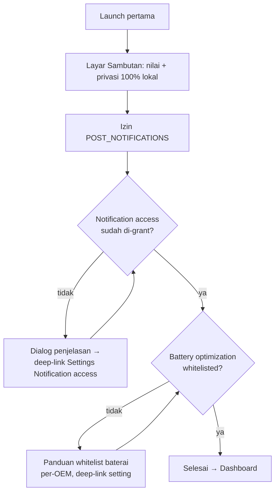
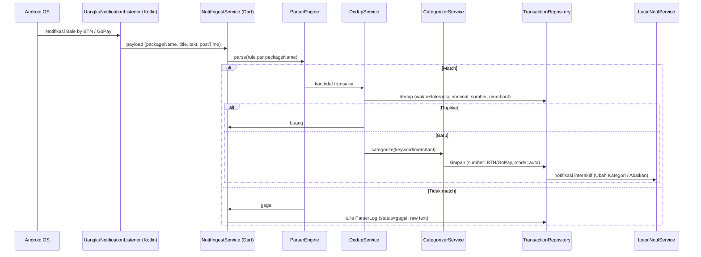
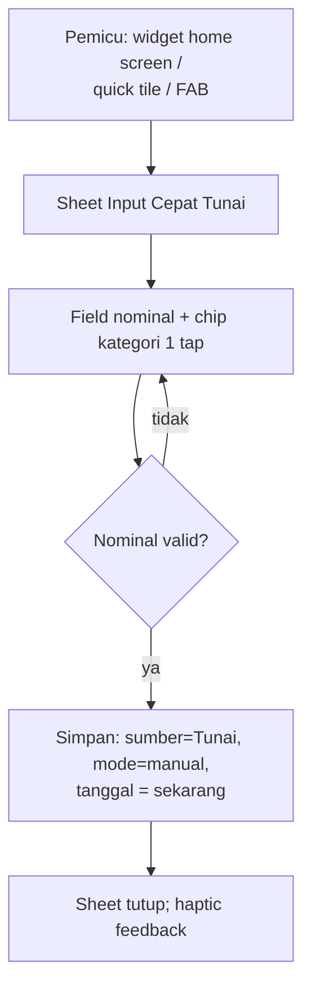
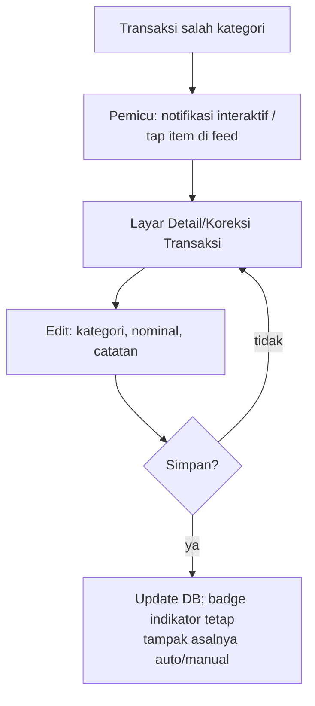

# 03 — App Flow Documentation (AFD): Uangku

> Sumber kebenaran: `brainstorm-finance-app.md`, `docs/01-PRD.md` (FR-xx), `docs/02-TRD.md` (nama komponen).

## 1. Peta Navigasi Layar

```
Bottom Navigation (3 tab):
  1. Dashboard (default)
  2. Transaksi (feed)
  3. Pengaturan

Layar lain (diakses dari tab / deep-link):
  - Input Cepat Tunai (overlay/sheet, dari widget, tile, atau tombol FAB)
  - Detail/Koreksi Transaksi (dari feed atau notifikasi interaktif)
  - Log Parser (dari Pengaturan)
  - Uji Rule Parser (dari Log Parser)
  - Onboarding (sekali, sebelum tab utama)
```

## 2. Onboarding



- Status listener dan whitelist ditampilkan ulang di **Pengaturan** (indikator hijau/merah) — mitigasi R-04.
- Onboarding bisa dilewati, tapi banner peringatan muncul sampai kedua izin aktif.

## 3. Alur Pencatatan Otomatis (notifikasi → tersimpan)



- Notifikasi interaktif: **Ubah Kategori** → deep-link layar Detail/Koreksi; **Abaikan** → tutup notifikasi saja (transaksi tetap tersimpan) (FR-05).
- Notifikasi tertunda/ganda ditahan dedup (FR-03).

## 4. Alur Input Cepat Tunai



- Target < 5 detik (FR-07, NFR-05): tanpa catatan wajib, tanpa pemilih tanggal.
- Dari quick tile: membuka Activity transparan berisi sheet yang sama.

## 5. Alur Koreksi Kategori



- Koreksi tidak mengubah rule parser otomatis (pembelajaran rule = fase 2).

## 6. Alur Debug Parser

```mermaid
flowchart TD
    A[Pengaturan → Log Parser] --> B[Riwayat raw notifikasi:\ntext, packageName, status parse]
    B --> C{Pilih entri gagal / tap Uji Rule}
    C --> D[Layar Uji Rule Parser]
    D --> E[Input raw text + pilih rule → hasil parse live]
    E --> F{Pattern perlu ubah?}
    F -- ya --> G[Edit regex rule (JSON, in-app)]
    G --> E
    F -- tidak --> H[Selesai; rule tersimpan,\ntransaksi berikutnya pakai rule baru]
```

- Retensi ParserLog terbatas (LRU, default 200 entri) dan bisa dihapus pengguna (TRD §6).

## 7. Dashboard (tab utama)

- Picker periode: Harian / Mingguan / Bulanan.
- Kartu arus kas: total pemasukan vs pengeluaran periode.
- Donut/bar chart breakdown kategori (fl_chart).
- Preview feed transaksi terbaru → tap "lihat semua" ke tab Transaksi.

## 8. State Eksepsi

| Kondisi | Perilaku |
|---------|----------|
| Notification access dicabut saat app berjalan | Banner merah di Dashboard + Pengaturan; transaksi manual tetap jalan. |
| Notifikasi app lain selain Bale by BTN / GoPay | Diabaikan total (filter packageName). |
| DB kosong (baru install) | Empty state: ajakan coba input tunai / aktifkan listener. |
| Parse gagal | Transaksi tidak dibuat; entri ParserLog status=gagal; tidak ada notifikasi ke pengguna (tidak berisik). |
