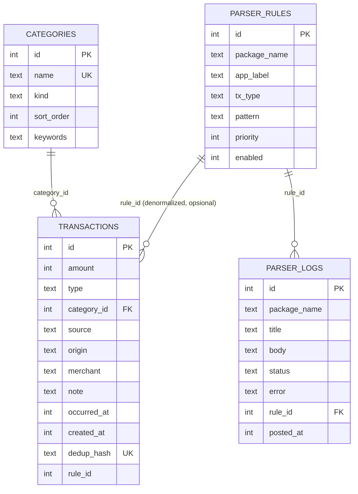

# 05 — Backend Schema Documentation (BSD): Uangku

> Aplikasi **local-first tanpa server**. "Backend" = penyimpanan lokal di perangkat.
> Sumber kebenaran: `brainstorm-finance-app.md`, `docs/02-TRD.md` (komponen), `docs/01-PRD.md` (FR-xx).

## 1. Tabel Lokal

### 1.1 `transactions`

| Kolom | Tipe | Constraint | Catatan |
|-------|------|------------|---------|
| `id` | INTEGER | PK, autoincrement | |
| `amount` | INTEGER | NOT NULL | Rupiah utuh, selalu positif; arah ditentukan `type`. |
| `type` | TEXT | NOT NULL CHECK IN (`income`,`expense`) | |
| `category_id` | INTEGER | NOT NULL, FK → `categories.id` | Default `Lainnya`. |
| `source` | TEXT | NOT NULL CHECK IN (`BTN`,`GOPAY`,`CASH`) | Badge sumber dana (FR-09). |
| `origin` | TEXT | NOT NULL CHECK IN (`auto`,`manual`) | Indikator auto vs manual (FR-09). |
| `merchant` | TEXT | NULL | Hasil parse / input manual opsional. |
| `note` | TEXT | NULL | Catatan opsional (tidak wajib, agar input cepat < 5 detik). |
| `occurred_at` | INTEGER | NOT NULL | Epoch ms; untuk auto = `postTime` notifikasi; untuk manual = waktu simpan. |
| `created_at` | INTEGER | NOT NULL | Epoch ms, waktu baris dibuat. |
| `dedup_hash` | TEXT | NOT NULL, UNIQUE | Hash dari (`source`,`amount`,`merchant`,`occurred_at` dibulatkan ke toleransi). Lihat §4. |
| `rule_id` | INTEGER | NULL | Denormalized, tanpa FK ketat; audit rule mana yang menghasilkan transaksi (null = manual/tunai). Lihat §6. |

**Index**: `idx_tx_occurred (occurred_at DESC)` — feed & agregasi dashboard; `idx_tx_category (category_id, occurred_at)` — chart kategori; `UNIQUE(dedup_hash)` — dedup (FR-03).

### 1.2 `categories`

| Kolom | Tipe | Constraint |
|-------|------|------------|
| `id` | INTEGER | PK, autoincrement |
| `name` | TEXT | NOT NULL UNIQUE |
| `kind` | TEXT | NOT NULL CHECK IN (`income`,`expense`) |
| `sort_order` | INTEGER | NOT NULL |
| `keywords` | TEXT | NULL — JSON array keyword/merchant untuk auto-kategorisasi (FR-04), editable in-app fase lanjutan. |

Seed sesuai FR-11:
- `expense`: Makanan & Minuman, Transportasi, Kos & Tagihan, Belanja, Hiburan, Kesehatan, Pendidikan, Lainnya.
- `income`: Uang Saku, Gaji/Part-time, Transfer Masuk, Lainnya.

### 1.3 `parser_rules`

| Kolom | Tipe | Constraint | Catatan |
|-------|------|------------|---------|
| `id` | INTEGER | PK, autoincrement | |
| `package_name` | TEXT | NOT NULL | `packageName` aplikasi sumber (Bale by BTN / GoPay — nilai persisnya dari perangkat asli, lihat OQ-01/OQ-02). |
| `app_label` | TEXT | NOT NULL | Nama tampil: `BTN` / `GoPay`. |
| `tx_type` | TEXT | NOT NULL CHECK IN (`income`,`expense`) | Rule ini menghasilkan tipe apa. |
| `pattern` | TEXT | NOT NULL | Regex dengan named groups: `amount`, `merchant`, `event_time` (opsional). |
| `priority` | INTEGER | NOT NULL DEFAULT 0 | Urutan evaluasi per app. |
| `enabled` | INTEGER | NOT NULL DEFAULT 1 | |

Editable in-app tanpa recompile (FR-10, NFR-06). Bentuk serialisasi JSON lihat §5.

### 1.4 `parser_logs`

| Kolom | Tipe | Constraint | Catatan |
|-------|------|------------|---------|
| `id` | INTEGER | PK, autoincrement | |
| `package_name` | TEXT | NOT NULL | |
| `title` | TEXT | NOT NULL | |
| `body` | TEXT | NOT NULL | Raw text notifikasi (sensitif — retensi LRU, default 200 entri, bisa dihapus pengguna; TRD §6). |
| `status` | TEXT | NOT NULL CHECK IN (`parsed`,`failed`,`ignored`) | `ignored` = app lain/filter dedup. |
| `error` | TEXT | NULL | Pesan singkat jika `failed`. |
| `rule_id` | INTEGER | NULL, FK → `parser_rules.id` | Rule yang match. |
| `posted_at` | INTEGER | NOT NULL | `postTime` notifikasi. |

**Index**: `idx_plog_posted (posted_at DESC)`.

## 2. ERD



## 3. Kontrak Data Kotlin ↔ Flutter

**Arah utama: Kotlin → Dart (EventChannel `uangku/notif_events`).**

```json
{
  "package_name": "com.example.balebybtn",
  "title": "Bale by BTN",
  "text": "<teks notifikasi apa adanya>",
  "post_time": 1730000000000,
  "key": "<notification key unik dari OS>"
}
```

- Dart tidak pernah menerima objek notifikasi OS — hanya map primitif di atas (aman JSON).
- Filter `package_name` dilakukan di sisi Kotlin (whitelist Bale by BTN + GoPay) untuk hemat isolate wake.
- **Dart → Kotlin (MethodChannel `uangku/platform`)**:
  - `openNotificationAccessSettings()` — deep-link Settings.
  - `isListenerEnabled(): bool`.
  - `openQuickCashActivity()` — dari quick tile/widget.
  - `isBatteryOptimizationIgnored(): bool`.
- **Kotlin → Dart (dari widget/tile, MethodChannel)**: event `open_quick_cash` — app di-deep-link ke QuickCashSheet (AFD §4).

## 4. Aturan Dedup

1. Kunci dedup: hash kanonikal dari (`source`, `amount`, `merchant` dinormalisasi uppercase/trim, `occurred_at` dibulatkan ke toleransi).
2. Toleransi waktu: bucket 60 detik (notifikasi ganda/tertunda beda detik; transaksi berbeda dalam 1 menit dengan nominal & merchant sama dianggap satu — batasan diterima, dicatat R-02).
3. Dua lapis: (a) lookup `dedup_hash` sebelum insert — UNIQUE constraint sebagai pengaman terakhir; (b) cek transaksi existing di window ±toleransi dengan source+amount+merchant sama.
4. Entri `parser_logs` tetap dicatat dengan status `ignored` untuk audit, meski transaksi dibuang.
5. Notifikasi yang tidak menghasilkan kandidat parse (gagal) tidak masuk dedup.

## 5. Struktur Rule Parser (JSON)

Rule diekspor/impor in-app dan bisa di-preview di layar Uji Rule Parser (FR-10). Format konfigurasi:

```json
{
  "version": 1,
  "rules": [
    {
      "package_name": "<dari perangkat asli — belum diketahui>",
      "app_label": "BTN",
      "tx_type": "expense",
      "priority": 0,
      "enabled": true,
      "pattern": "<regex asli, named groups: (?<amount>...) (?<merchant>...) (?<event_time>...)>"
    }
  ]
}
```

- **Pattern TIDAK dikarang di dokumen ini.** Format notifikasi Bale by BTN & GoPay belum diketahui (OQ-01, OQ-02); pattern awal hanya dibuat setelah sampel asli terkumpul (task M2 di `06-IPD.md`).
- Named groups wajib: `amount`; opsional: `merchant`, `event_time`. Grup tak ada → fallback `merchant=null`, waktu = `post_time`.
- `version` untuk migrasi format file rule (§7).

## 6. Relasi & Integritas

- `transactions.category_id` → `categories.id`: FK, kategori `Lainnya` (per kind) tidak boleh dihapus (protect delete).
- `parser_logs.rule_id` → `parser_rules.id`: FK SET NULL (log tetap ada jika rule dihapus).
- `transactions.rule_id` denormalized (tanpa FK ketat) untuk audit; boleh null (transaksi manual/tunai).
- Hapus transaksi = hard delete lokal (tanpa soft delete di MVP).

## 7. Strategi Migrasi

- DB versi via `schemaVersion` (drift) atau mekanisme setara (Isar); migrasi satu arah, tanpa downgrade.
- Prinsip MVP: tambah kolom/tabel selalu dengan default nullable/backup-safe; mengganti kolom = tambah baru + copy + drop.
- Seed kategori idempotent (insert-or-ignore by unique `name`+`kind`) agar upgrade tidak menduplikasi seed.
- File JSON rule berversi (`version`): migrasi file terpisah dari migrasi DB; rule lama tetap jalan sampai diubah in-app.
- Data pengguna tidak pernah dimigrasi keluar perangkat (NFR-01).

## 8. Ukuran & Retensi

- `parser_logs`: LRU max 200 entri (hapus tertua saat insert melebihi batas).
- `transactions`: tanpa batas di MVP (estimasi mahasiswa ~1.500/baris/tahun — dapat diabaikan untuk SQLite/Isar).
